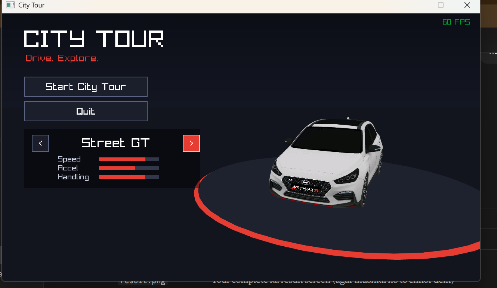
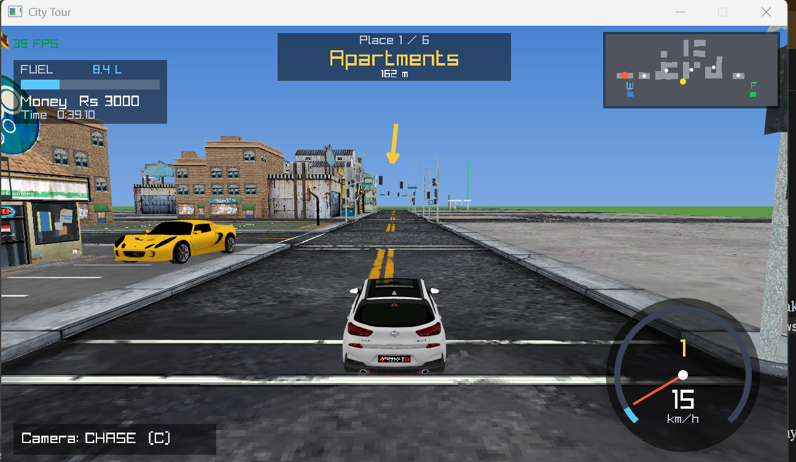
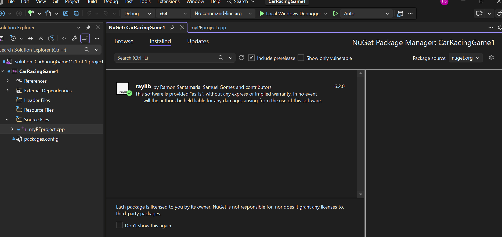

# City Tour

A 3D city driving game written in **C++** with the **raylib** library, built as a Programming Fundamentals (PF) project.

Drive through a city, visit six landmarks in order, and manage your fuel, money and random car breakdowns along the way.

Repository: https://github.com/HaleemaSadia528/CityTour



---

## 1. Project Overview

**City Tour** puts you behind the wheel of one of four cars (Street GT, Sprint R, Heavy Tourer, Electric GT). Your goal is to reach all six landmarks, in order, as fast as you can:

1. Apartments
2. Pawn Shop
3. Grand Hotel
4. Shopping Mall
5. Fish Factory
6. Clinic

Features:

- Car physics: acceleration, braking, handbrake, reverse, drag and tyre grip
- Three camera modes: chase, bonnet and cockpit
- Collision with buildings
- Fuel system with a petrol station (refuel for money)
- Random breakdowns (flat battery, overheating, low oil, flat tyre, out of fuel)
- Workshop for repairs and a tow truck that takes you to the workshop
- Minimap, speedometer, direction arrow and on-screen HUD
- Best tour time saved to a file (`citytour.txt`)
- Pause menu and a result screen
- Sound effects and an engine sound that follows your speed



### Controls

| Key | Action |
|---|---|
| **W** / Up Arrow | Accelerate |
| **S** / Down Arrow | Brake, then reverse |
| **A / D** or Left / Right Arrow | Steer |
| **Space** | Handbrake |
| **C** | Change camera (Chase / Bonnet / Cockpit) |
| **F** (hold, at the petrol station) | Refuel |
| **Enter** (at the workshop) | Repair the car |
| **T** (during a breakdown) | Call the tow truck |
| **P** or **Esc** | Pause / Resume |
| **F11** | Switch between fullscreen and windowed mode (on many laptops: **Fn + F11**) |
| **Left / Right Arrow** (in the menu) | Choose a car |

---

## 2. Prerequisites

- Windows 10 or Windows 11 (64-bit)
- **Visual Studio Community 2026** (Visual Studio 2022 should also work) with the workload **"Desktop development with C++"**
- An internet connection for the first build (to download the raylib NuGet package)
- Git (included with Visual Studio) or GitHub Desktop, to clone the repository

Library used (see `lib/libraries.txt`):

| Library | Version | How it is installed |
|---|---|---|
| raylib | 6.2.0 | NuGet package (restored automatically by Visual Studio) |



---

## 3. Installation and Setup

1. **Clone the repository**
   - In Visual Studio: **Git > Clone Repository**, paste `https://github.com/HaleemaSadia528/CityTour.git`, choose a folder and click **Clone**.
   - Or download the ZIP from GitHub (**Code > Download ZIP**) and extract it.
2. Open the folder and double-click **`CarRacingGame1.sln`** (Visual Studio opens the project).
3. Wait a few seconds. Visual Studio restores the **raylib 6.2.0** NuGet package automatically.
   - If it does not, right-click the solution in Solution Explorer and choose **Restore NuGet Packages**.
4. In the top toolbar select **Debug** and **x64** (not Win32).

---

## 4. Steps to Compile and Run on a New PC

1. Make sure the folder **`resources`** is in the same folder as `CarRacingGame1.vcxproj` (it already is in this repository). It contains the 3D models (`.glb`), sounds (`.wav`) and the font.
2. In Visual Studio choose **Build > Build Solution** (`Ctrl + Shift + B`). The build should end with `1 succeeded, 0 failed`.
   - Some warnings (for example `C4244` and `LNK4098`) are normal and do not stop the game.
3. Press **F5** (Start Debugging) or **Ctrl + F5** (Start Without Debugging).
4. The game starts in **fullscreen**. Press **F11** (or **Fn + F11** on a laptop) to switch to a window.
5. On the menu choose a car with the arrow buttons and click **Start City Tour**.

You can also run the built game directly from `x64\Debug\CarRacingGame1.exe`. Keep the `resources` folder next to the project folder, because the game looks for it automatically.

---

## 5. Configuration / Environment Notes

- **Platform and configuration:** Debug, x64.
- **Resources folder:** the game searches for `resources` in the current folder, in the folder of the `.exe`, and up to two folders above it (for example when the exe is in `x64\Debug`).
- **Missing files are optional.** If a model, sound or font file is missing, the game uses simple shapes or skips the sound instead of crashing.
- **Best time file:** `citytour.txt` is created in the working folder after you finish a tour. Delete it to reset the best time.
- **Window size:** the game starts fullscreen and uses 1280 x 720 in windowed mode.

---

## 6. Troubleshooting

| Problem | Solution |
|---|---|
| **Nothing seems to happen when I press F5** | The game starts in fullscreen, so the window may look like it is not there. Press **Fn + F11** (or **F11**) to get a normal window. To quit: **Alt + F4**. |
| **F11 only changes screen brightness (laptops, for example Dell XPS)** | Hold **Fn** and press **F11**. You can also press **Fn + Esc** to toggle the Fn lock. |
| **`raylib.h` not found / unresolved external symbols** | The NuGet package was not restored. Right-click the solution and choose **Restore NuGet Packages**, then rebuild. Check that the platform is **x64**. |
| **Build fails with Win32 selected** | Change the platform to **x64** in the toolbar. |
| **Game shows plain boxes instead of cars or the city** | The `resources` folder was not found. Make sure `resources` is next to `CarRacingGame1.vcxproj` and contains the `models` folder. A message in the game also tells you when `city.glb` is missing. |
| **No sound** | The sound files in `resources/sounds` are missing or no audio device is available. The game still runs without sound. |
| **Low frame rate** | Switch the build to **Release** (Build configuration in the toolbar) and make sure the laptop is plugged in and uses the dedicated GPU if available. |
| **Cannot quit with Esc** | By design: **Esc** pauses the game. Use the **Quit** button on the menu, or **Alt + F4**. |
| **Warnings during build (`C4244`, `LNK4098`)** | These are harmless warnings and not errors. |

---

## 7. Project Structure

```
CityTour/
|-- myPFproject.cpp             main source file (all game code)
|-- CarRacingGame1.sln          Visual Studio solution
|-- CarRacingGame1.vcxproj      Visual Studio project
|-- packages.config             NuGet packages (raylib 6.2.0)
|-- resources/                  models (.glb), sounds (.wav), fonts
|-- lib/
|   `-- libraries.txt           libraries and versions used
|-- screenshots/                images used in this README
`-- README.md
```

---

## 8. Authors

- HaleemaSadia528
- shahidmaryam2712

Course: Programming Fundamentals (PF), FAST-NUCES.
